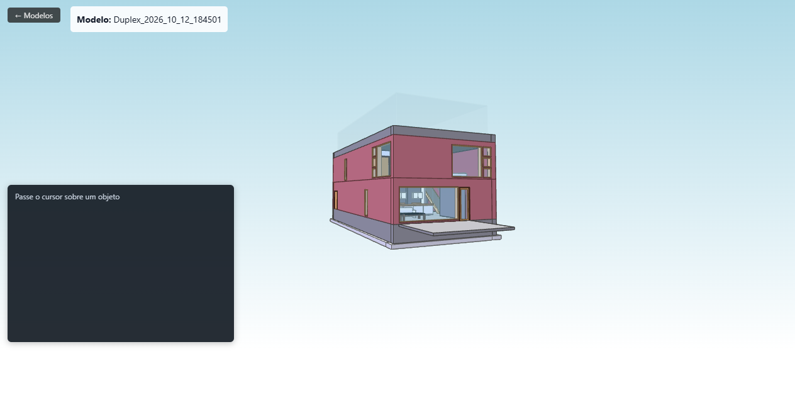
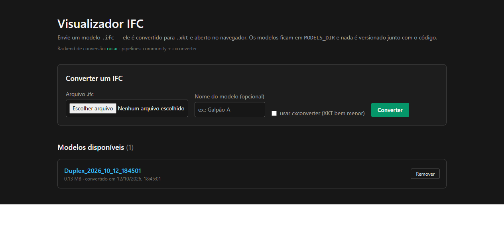

# Visualizador IFC

Aplicação web que **converte modelos IFC em XKT** e os abre no navegador com o
[xeokit](https://xeokit.io/): câmera orbital, ferramenta de medição, planos de
corte e um painel que mostra os dados do elemento sob o cursor (nome, tipo,
perfil e propriedades vindas do próprio IFC).





*Modelo das imagens: [Duplex](https://github.com/xeokit/xeokit-convert), a
amostra que acompanha o repositório do `xeokit-convert`. Nenhum modelo é
versionado neste repositório.*

---

## O que ela faz

1. **Converte** — você envia um `.ifc`; o backend chama o `convert2xkt` e grava
   o `.xkt` numa pasta local (`MODELS_DIR`).
2. **Lista** — a tela inicial mostra os modelos disponíveis, com tamanho e data
   de conversão.
3. **Visualiza** — o viewer carrega o XKT por streaming e monta a cena: o mesmo
   pipeline serve para um galpão metálico de 1 MB e para um modelo de centenas
   de MB.

Não há banco de dados. O estado do sistema é a pasta de modelos: o que está lá é
o que o viewer abre. Isso deixa a aplicação de pé com duas dependências
(Python e o pacote de conversão do Node) e faz com que nenhum dado de cliente
precise entrar no repositório. **O navegador nunca recebe o IFC**: o arquivo é
convertido no servidor e só o XKT chega ao viewer (que importa o
`XKTLoaderPlugin`, sem nenhum parser de IFC).

## Origem desta cópia

Este projeto é um **recorte** de um sistema interno maior de gestão de obras.
Daquele sistema vieram o conversor IFC→XKT e o viewer; ficaram de fora — por
serem outro produto — o banco relacional com apontamento de horas e custos, os
relatórios e o BI, as variáveis categóricas de obra e o agente de IA que
conversa com o modelo 3D.

O que mudou nesta separação, além de remover as partes que não pertencem a um
visualizador:

| No sistema original | Aqui |
|---|---|
| Banco relacional (Prisma/PostgreSQL) com o catálogo de modelos | a pasta `MODELS_DIR` é a fonte da verdade |
| Importação de biblioteca comercial de UI (Syncfusion) no layout raiz | removida: o visualizador não usa nenhum componente dela |
| Agente de IA acoplado ao viewer (API semântica exposta em `window`) | removido, junto com o WebSocket do agente |
| Formulário de características da obra gravando no banco | removido |
| Conversão em dois passos, pelo `cxconverter` (proprietário) + `convert2xkt` | uma ferramenta só, aberta: `convert2xkt` lendo o IFC direto (veja abaixo o motivo) |
| Nome de arquivo do XKT montado a partir de obra + prédio + data | nome do modelo + data e hora |
| Leitura de arquivo de modelo sem validar o nome vindo da URL | validação de caminho em toda rota que recebe nome de arquivo |

## Como rodar

### Pré-requisitos

- **Python 3.11+** (backend)
- **Node.js 20+** (frontend) e o pacote de conversão:

```bash
npm install -g @xeokit/xeokit-convert
```

### Backend (conversão e entrega dos XKT)

```bash
cd backend
python -m venv .venv
.venv/Scripts/python -m pip install -r requirements.txt   # Linux/macOS: .venv/bin/python
.venv/Scripts/python main.py                              # http://localhost:9000
```

O backend também funciona sozinho, pela linha de comando:

```bash
.venv/Scripts/python converter_ifc.py modelo.ifc --destino var/app-data/models
.venv/Scripts/python converter_ifc.py --listar-ferramentas
```

### Frontend

```bash
npm install
cp .env.example .env      # ajuste MODELS_DIR e BACKEND_URL se precisar
npm run dev               # http://localhost:3000
```

Em produção: `npm run build && npm start`.

## A conversão, medida

Um modelo de 1,2 MB de estrutura metálica (exportado do Tekla Structures), na
mesma máquina:

| | |
|---|---|
| Comando | `convert2xkt -s modelo.ifc -b -o modelo.xkt` |
| **XKT gerado** | **1,29 MB** |
| Metaobjetos | 751 |
| Property sets | 249 (com os valores inline) |
| Triângulos | 736.920 |
| Tempo (aquecido) | 5,6 s |

Duas coisas que custaram para descobrir e ficam registradas:

- **O `-b` (compressBuffers) é decisivo.** Sem ele o XKT sai com os buffers e o
  metadado sem compressão: **14,03 MB** contra 1,29 MB no mesmo modelo — onze
  vezes mais, e o metadado vai junto sem compactar.
- **A primeira conversão depois de ligar a máquina é bem mais lenta.** Node
  subindo e o módulo wasm do `web-ifc` carregando custam segundos que não
  aparecem no tempo interno do conversor: o mesmo modelo levou **22 s a frio
  contra 5,6 s aquecido**.

## Por que existe um pipeline só

O xeokit documenta um pipeline alternativo, de duas ferramentas, que preserva o
reaproveitamento de geometria que já existe no IFC e entrega um XKT bem menor.
Ele foi implementado aqui, medido — e removido:

| | `convert2xkt` (usado) | `cxconverter` + `convert2xkt` (removido) |
|---|---|---|
| Ferramentas | 1, open source | 2, a primeira proprietária |
| XKT (modelo de 1,2 MB) | 1,29 MB | **0,14 MB** |
| Property sets | 249 | **484** |
| Tempo | 5,6 s | 2,0 s |
| Licença | nenhuma | comercial, da Creoox |

O motivo de não usar o segundo: a versão gratuita do `cxconverter` (ifc2gltf) é
a **de avaliação**, e ela não é neutra. O binário reescreve o nome do
`IfcProject` no metadado, acrescentando `- evaluation version` — que é o nome
que o viewer mostra como nome do modelo. Verificado convertendo o mesmo IFC
pelos dois caminhos:

| | Ocorrências de "evaluation" |
|---|---|
| O IFC de entrada | **0** |
| Saída do `cxconverter` (JSON e XKT) | **1** — no nome do projeto |
| Saída do `convert2xkt` | **0** |

E a conversão **não avisa**: a saída do executável de avaliação é idêntica à de
uma licenciada. A marca só sai comprando licença e preenchendo `licenceKey` no
`cxconverter.json` (o arquivo de configuração que acompanha o binário). Como
existe um caminho gratuito, limpo e sem intermediário proprietário, o projeto
usa só ele e aceita o arquivo maior.

## Estrutura

```
backend/
  main.py              API FastAPI: /converter, /modelos, DELETE /modelos/{nome}
  converter_ifc.py     conversão IFC → XKT (uma ferramenta, sem shell no comando)
  requirements.txt
app/
  routes/_index.tsx        galeria: converte, lista e remove modelos
  routes/viewer.$filename.tsx  abre um modelo no viewer
  routes/models.$filename.ts   entrega o .xkt por streaming
  components/XeokitViewer.tsx  cena xeokit (câmera, medição, corte, pick)
  components/XeokitLayout.tsx  tela do viewer e painel do objeto sob o cursor
  utils/models.server.ts   a pasta de modelos como fonte da verdade
  utils/api.backend.ts     cliente do backend de conversão
docs/imagens/          imagens deste README
var/app-data/models/   onde os .xkt ficam (fora do git)
```

## Limitações conhecidas

- **Modelos grandes produzem XKT grandes.** Sem o reaproveitamento de geometria
  do pipeline removido, a geometria é achatada e o arquivo cresce junto com o
  modelo, sem a deduplicação de malhas que a outra ferramenta fazia. Para
  modelos de centenas de MB, as saídas são o pipeline licenciado (acima) ou
  reduzir o modelo antes de converter — o `-i`/`-x` do `convert2xkt` inclui ou
  exclui tipos de elemento, e converter por disciplina ou por pavimento diminui
  muito o resultado.
- O **painel do objeto sob o cursor** não pôde ser verificado por automação (o
  hover depende do ponteiro real sobre o canvas); o código é o do sistema de
  origem, sem alteração.
- O upload do frontend passa pela memória do servidor do Remix — modelos da
  ordem de centenas de MB pedem um *upload handler* em disco.
- A conversão é **síncrona**: para um IFC grande a requisição fica aberta até o
  fim.
- Não há autenticação: a aplicação foi feita para rodar em rede local. Publicar
  na internet exige pôr autenticação na frente.
- O `-i`/`-x` do `convert2xkt` (incluir/excluir tipos) não é exposto na
  interface — é o caminho natural para reduzir o tamanho de um modelo grande.

## Licença

O código deste repositório está sob **MIT** (veja [LICENSE](LICENSE)). A
dependência principal é o **xeokit-sdk, que é AGPL-3.0**: como este projeto é
aberto, a obrigação de disponibilizar a fonte está atendida; uso comercial do
SDK sem abrir o código exige licença da xeokit. Não há mais nenhuma dependência
proprietária — veja
[docs/creditos-e-licencas.md](docs/creditos-e-licencas.md).
